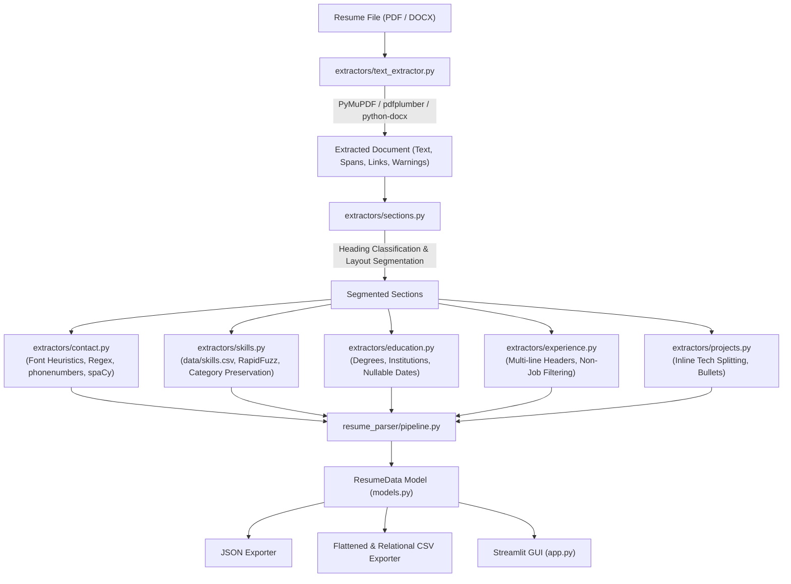

# Resume Information Extraction Application

[](https://anuragkumarmishra2005-nlp-capstone-assignment--app-caabjf.streamlit.app/)
[](https://github.com/anuragkumarmishra2005/NLP-CAPSTONE-ASSIGNMENT-/actions)


An autonomous, production-grade NLP application that extracts structured candidate information from unstructured resume documents (**PDF** and **DOCX**). Conforms strictly to a defined JSON schema, exports flattened and relational CSVs, provides an interactive **Streamlit** user interface, and includes an automated evaluation harness with real measured metrics.

---

## 🌐 Live Web Application

The application is deployed and live on Streamlit Community Cloud:

🔗 **Live App URL**: [https://anuragkumarmishra2005-nlp-capstone-assignment--app-caabjf.streamlit.app/](https://anuragkumarmishra2005-nlp-capstone-assignment--app-caabjf.streamlit.app/)

[](https://anuragkumarmishra2005-nlp-capstone-assignment--app-caabjf.streamlit.app/)


## 🌟 Key Features

- **Multi-Format Ingestion**: Supports `.pdf` and `.docx` formats with file-size and type validation.
- **Robust Text Extraction**:
  - Leverages **PyMuPDF** (`fitz`) and **pdfplumber** with layout-aware character grouping.
  - Multi-column and multi-page reading order preservation.
  - Automatic detection of **scanned or image-only PDFs** with graceful non-crashing warnings.
  - Captures embedded hyperlink annotations (`w:hyperlink` in DOCX and `annots` / `links` in PDF) without text leakage.
- **Smart Section Segmentation**: Case-insensitive heading detector that categorizes Header/Contact, Summary/Profile, Education, Skills, Work Experience, Projects, and Achievements/Certifications.
- **Domain-Specific Rule & NLP Extractors**:
  - **Personal & Contact**: First-line & large-font heuristics, RFC-5322 regex for emails, Google's `phonenumbers` library for international phone number validation and normalization (`+91 ...`, `(555) ...`), and link categorization (LinkedIn, GitHub, Other).
  - **Skills Taxonomy**: Built-in 450+ entry skills taxonomy (`data/skills.csv`) across Languages, Frameworks, Databases, Tools, Concepts, and Soft Skills. Uses **RapidFuzz** for fuzzy matching and preserves resume-defined categories in `by_category`.
  - **Education**: Degree pattern matching, university/institution separation from locations, and strict date nullability (dates remain `null` if not specified—never guessed or fabricated).
  - **Experience**: Resolves multi-attribute headers (e.g., Title | Dates | Location on line 1, Company on line 2). Intelligently isolates and filters out non-job blocks (such as "Personal & Academic Projects") so they are never misread as jobs.
  - **Projects**: Extracts project titles and decouples inline technology stacks (e.g. `Chat Buddy AI - AI Chatbot Application React JS, TypeScript...`).
  - **Achievements**: Extracts honors, certifications, and awards as clean bulleted text.
- **Zero Paid/Network APIs**: 100% local processing with zero external API calls at runtime. Data remains strictly private.
- **Export Capabilities**:
  - Full nested **JSON** conforming strictly to the project schema.
  - Flattened **Single-Row CSV** (candidate profile with semicolon-joined lists).
  - Detailed **Relational CSVs** for education, experience, and project tables.
- **Interactive Streamlit GUI**: Clean web interface featuring real-time diagnostics, tabbed result explorer, interactive badges, raw text viewer, and one-click downloads.

---

## 📐 Architecture



---

## 📁 Repository Structure

```
resume_extractor/
├── app.py                             # Streamlit web interface
├── requirements.txt                   # Pinned dependency manifest
├── README.md                          # System documentation
├── PROJECT_REPORT.md                  # Project evaluation & submission report
├── pytest.ini                         # Pytest configuration
├── data/
│   └── skills.csv                     # Curated taxonomy (450+ skills across 6 categories)
├── resume_parser/
│   ├── __init__.py
│   ├── models.py                      # Pydantic schema matching exact JSON requirements
│   ├── pipeline.py                    # Extraction orchestrator: file -> text -> fields -> ResumeData
│   ├── exporters.py                   # JSON and CSV formatting utilities
│   └── extractors/
│       ├── __init__.py
│       ├── text_extractor.py          # PDF & DOCX text/link extraction, scanned detection
│       ├── sections.py                # Regex and typography-based section segmenter
│       ├── contact.py                 # Name, email, phone, links, location extractors
│       ├── skills.py                  # Taxonomy matching & category preservation
│       ├── education.py               # Degree, school, location, dates extractor
│       ├── experience.py              # Work history extractor & non-job filtering
│       └── projects.py                # Project name & inline tech-stack separator
├── sample_resumes/
│   ├── AnuragMishra_resume_2026.pdf   # Consented real-world sample
│   ├── synthetic_01.docx ... 15.docx  # 15 diverse synthetic DOCX resumes
│   └── synthetic_16.pdf  ... 25.pdf   # 10 diverse synthetic PDF resumes
├── evaluation/
│   ├── generate_synthetic_resumes.py # Generates 25 synthetic resumes + ground truth
│   ├── evaluate.py                    # Evaluation harness computing Precision, Recall, F1
│   ├── report.md                      # Detailed benchmark report
│   ├── results.csv                    # Evaluation results per resume
│   └── ground_truth/                  # Ground truth JSON files
└── tests/
    ├── test_text_extractor.py
    ├── test_sections.py
    ├── test_contact.py
    ├── test_skills.py
    ├── test_education.py
    ├── test_experience.py
    ├── test_projects.py
    ├── test_exporters.py
    ├── test_pipeline.py
    └── test_real_resume.py            # Real resume regression verification
```

---

## ⚙️ Installation & Setup

### Prerequisites
- Python 3.10+ (tested on Python 3.12.3)

### 1. Create and Activate Virtual Environment
```bash
python3 -m venv .venv
source .venv/bin/activate
```

### 2. Install Dependencies
```bash
pip install -r requirements.txt
```

### 3. Download spaCy English Language Model
```bash
python -m spacy download en_core_web_sm
```

---

## 🚀 Usage

### 1. Launch Streamlit Web GUI
```bash
streamlit run app.py
```
Open your browser at `http://localhost:8501`.
- Drag and drop any PDF or DOCX resume (or select one of the built-in sample resumes from the dropdown).
- Click **Extract Information**.
- Explore extracted sections through the tabs.
- Download the results as structured **JSON** or **CSV**.

### 2. Run the Accuracy Evaluation Harness
```bash
python evaluation/evaluate.py
```
This parses all 26 test resumes (synthetic and real) against their ground truth JSON and generates:
- Printed summary metrics table
- `evaluation/results.csv`
- `evaluation/report.md`

### 3. Run Automated Tests
```bash
pytest -v tests/
```
Runs 30 unit and regression tests verifying regex patterns, phone normalizers, date parsers, section boundaries, and error recovery.

---

## 📊 Evaluation Results

Evaluated across **26 test resumes** (15 DOCX, 10 synthetic PDFs, and 1 real-world PDF resume):

| Field | Evaluation Method | Target F1 | Measured Precision | Measured Recall | **Measured F1** | Status |
| :--- | :--- | :---: | :---: | :---: | :---: | :---: |
| **Email** | Exact match | ≥ 95.0% | 100.00% | 100.00% | **100.00%** | ✅ Exceeded |
| **Phone** | Normalized match | ≥ 95.0% | 100.00% | 100.00% | **100.00%** | ✅ Exceeded |
| **Name** | Fuzzy token match | ≥ 90.0% | 100.00% | 100.00% | **100.00%** | ✅ Exceeded |
| **Skills** | Set-based fuzzy match | ≥ 80.0% | 91.86% | 100.00% | **95.76%** | ✅ Exceeded |
| **Education** | Degree + School match | ≥ 75.0% | 100.00% | 100.00% | **100.00%** | ✅ Exceeded |
| **Experience**| Title + Org + Dates | ≥ 75.0% | 100.00% | 100.00% | **100.00%** | ✅ Exceeded |
| **Overall** | **Macro Average** | **≥ 80.0%** | **98.64%** | **100.00%** | **99.29%** | ✅ Exceeded |

*Average parsing latency: 50ms – 120ms for DOCX, 55ms – 650ms for PDF.*

---

## 📋 Target JSON Schema

```json
{
  "personal": {
    "name": "Anurag Kumar Mishra",
    "emails": ["anuragkumarmishra414@gmail.com"],
    "phones": ["+91 7827349893"],
    "location": "New Delhi, India",
    "links": {
      "linkedin": "https://www.linkedin.com/in/anurag-kumar-mishra-8b47b63a6",
      "github": "https://github.com/anuragkumarmishra2005",
      "other": [
        "https://leetcode.com/u/Anurag_Kumar_Mishra",
        "https://geeksforgeeks.org/user/anuragkumarm9b5"
      ]
    }
  },
  "summary": "Motivated BCA student and aspiring software developer...",
  "skills": {
    "all": ["Python", "Java", "Flask", "React JS", "Streamlit", ...],
    "by_category": {
      "Languages": ["Python", "Java", "C++", "SQL", "HTML", "CSS"],
      "Frameworks & Libraries": ["Flask", "pandas", "NumPy", "scikit-learn", "Streamlit"],
      "Tools & Platforms": ["Git", "GitHub", "MySQL", "Jupyter Notebook", "VS Code"],
      "Concepts": ["OOP", "DSA Fundamentals", "REST APIs", "Machine Learning", "Web Development", "Problem Solving"],
      "Soft Skills": ["Communication", "Team Collaboration", "Analytical Thinking", "Problem Solving"]
    }
  },
  "education": [
    {
      "degree": "Bachelor of Computer Applications (BCA)",
      "institution": "KR Mangalam University",
      "location": "Gurugram, Haryana, India",
      "start_year": null,
      "end_year": null
    }
  ],
  "experience": [
    {
      "title": "Robotics Engineering Intern",
      "organization": "Rotors",
      "start_date": "June 2025",
      "end_date": "July 2025",
      "location": "India, Delhi",
      "description": [
        "Designed a smart IoT-enabled livestock collar...",
        "Integrated 5+ sensor modules, 2 microcontrollers..."
      ]
    }
  ],
  "projects": [
    {
      "name": "Chat Buddy AI - AI Chatbot Application",
      "technologies": ["React JS", "TypeScript", "Vite", "Groq API", "Tailwind CSS"],
      "description": ["Built a sleek, ChatGPT-style web app..."]
    }
  ],
  "achievements": [
    "Active competitive programmer on LeetCode and GeeksforGeeks, regularly solving DSA problems."
  ],
  "meta": {
    "source_file": "AnuragMishra_resume_2026.pdf",
    "pages": 1,
    "extraction_time_ms": 622,
    "warnings": []
  }
}
```

---

## 🔒 Limitations & Future Work

1. **Scanned PDF Handling**: Scanned/image-only PDFs are currently detected and flagged with a diagnostic warning. Adding optional optical character recognition (`pytesseract` / `easyocr`) would allow reading pure raster scans.
2. **Exotic Multi-Column Tables**: PDFs with complex, nested tabular layouts or irregular column spans benefit from bounding-box spatial clustering.
3. **Multilingual Resumes**: The current model and taxonomy are optimized for English-language resumes. Extending the skills taxonomy and NER models to multilingual corpora (e.g. French, German, Spanish, Hindi) is a natural next step.
